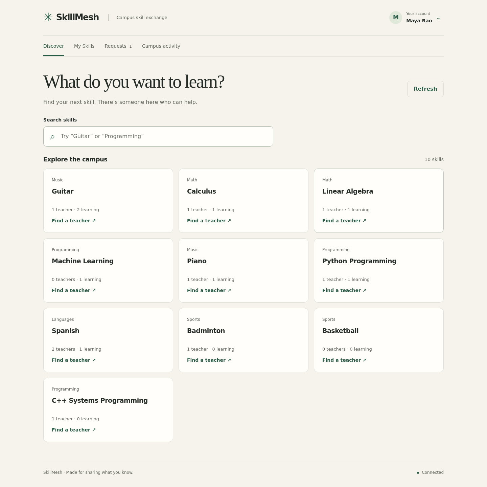

# SkillMesh

SkillMesh is a campus skill exchange. Students list what they can teach and want
to learn, find teachers, send requests, and follow their status. Moderators review
reports and manage the exchange.



## Run the demo

You need Docker with Compose v2. From the repository root:

```sh
set -a
. ./docs/demo.env
set +a
docker compose up -d --build --wait
docker compose exec -T web python scripts/seed_postgres.py
```

Open **http://localhost:18080**. Enter an email, password, and name, then choose
**Create account**. Seeded students have placeholder passwords; create your own
account to try the app.

The supplied environment uses a separate Compose project, ports, and volumes.
It leaves the default project's data and your local `.env` file alone.
Stop the demo with `docker compose down`; its volumes are kept.

## Try it

1. Create an account and search for **Guitar**.
2. Choose **I want to learn Guitar**, then **Send request** on Ananya Iyer's card.
3. Open **Requests** to see its **pending** status.
4. In **My Skills**, add something you can teach, such as Spanish.
5. Open **Campus activity** to see teaching, learning, and completed-session counts.

## Development and tests

With the demo environment loaded in the same shell:

```sh
python3 -m venv .venv
.venv/bin/python -m pip install -r requirements.txt
./demo prepare
./demo race
./demo tests
```

Tests need PostgreSQL, Redis, and Neo4j. `./demo race` runs two connections against
one slot and checks that exactly one booking succeeds. See the
[transaction](scripts/book.py), [database constraints](sql/02_schema.sql), and
[race tests](tests/test_concurrency.py). `./demo --help` lists the other CLI demos.

## Implementation

The browser uses plain JavaScript modules and CSS. Python's standard HTTP server
handles [routing](web/app.py), with separate auth, exchange, and moderation modules.
PostgreSQL stores the application data; pgvector ranks skill vectors by cosine
distance. Redis demonstrates expiring heartbeat keys, not Pub/Sub. Neo4j supports
explicit graph sync and relationship queries. Neither is used by the browser.

The lightweight Docker image uses lexical vectors. The full Python environment
can use MiniLM through sentence-transformers. To switch an isolated demo database,
run `.venv/bin/python scripts/seed_postgres.py --force` and serve it with
`.venv/bin/python web/app.py` at http://localhost:18081. Generate and write vectors
with the same encoder; mixing lexical and MiniLM vectors invalidates their scores.

Repository contributions are recorded in Git history, including DukeAvi and
Arjun Mohan Gowda. The original [ER diagram](Docs/skillmesh_er_chen.drawio) is kept.
